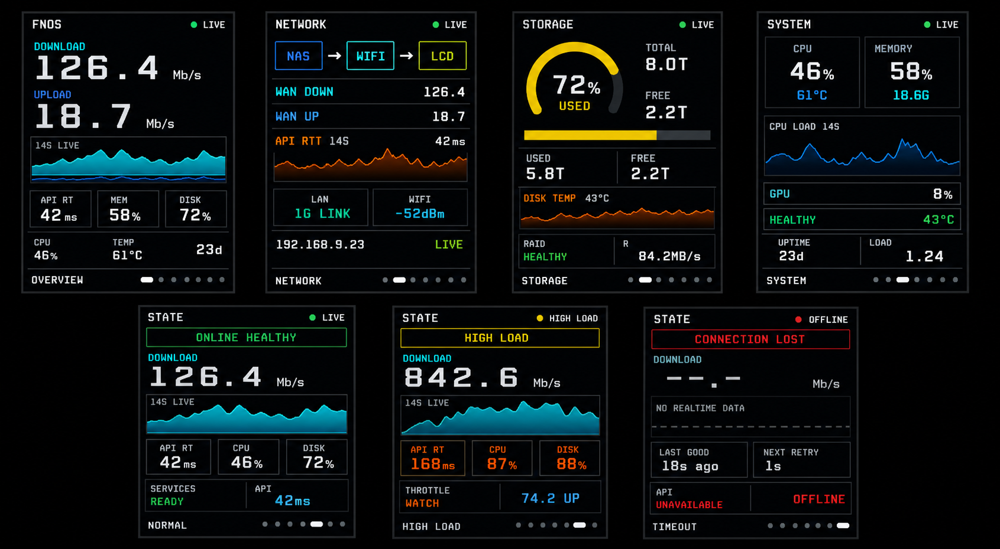

# fnOS Monitor UI v2 设计说明

本文描述 LilyGO T-Display-S3 fnOS Monitor 的第二版 UI。它采用 CUKTECH/酷态科式小屏设计语法，以“先识别对象和状态，再读取主值与趋势”为核心。

> 历史版本：本文保留第二版概念与既有验证记录。当前确定性七页实现、170×320 逐页设计稿和最新烧录证据以 [`ui-design-v3.md`](ui-design-v3.md) 为准；本文中的 imagegen 拼图不是逐像素固件截图。

## UI 渲染总览

渲染图包含七个页面：`OVERVIEW`、`NETWORK`、`STORAGE`、`SYSTEM`、`NORMAL`、`HIGH LOAD` 和 `TIMEOUT`。图中数值为展示信息层级使用的代表值，不是实时 NAS 数据。

## 设计合同

| 项目 | 约定 |
|---|---|
| 设备 | LilyGO T-Display-S3 |
| 显示面板 | ST7789，170×320，竖屏 |
| Profile | `system` 为主，`network` 为辅 |
| 观看方式 | 桌面近距离快速扫读，假设约 20–50 cm |
| 输入方式 | 两个物理按键，前后循环切页 |
| 数据来源 | 用户配置的真实 `fnos-exporter /metrics` |
| 数据采样 | 每 1 秒采集一次 |
| 页面刷新 | 需要时重建页面；切页动画约 60 fps |
| 夜间策略 | 背光上限 50%，首帧后短时渐亮 |
| 页面原则 | 每页只回答一个主问题；总量和对应拆解可视为同一个问题 |

## 信息层级

每个页面保持三层阅读顺序：

1. 第一眼：页面主问题的答案，例如下载速率、存储占用或连接状态。
2. 第二眼：答案的拆解，例如上传、CPU、内存、API RTT 或磁盘温度。
3. 第三眼：时间窗、单位、主机地址、运行时间和页面位置。

普通页面最多使用一个 Hero 主值、三项紧凑指标和一段趋势或状态上下文。卡片只代表真实对象、链路或传感器，不把普通文字全部包成卡片。

## 全局结构

### 顶栏

- 左侧为页面或系统标题。
- 右侧用“状态圆点 + 状态词”表达可信度或严重度。
- 标题和状态各自限制宽度，极端文案会缩短，不允许互相覆盖。

### 内容区

- 短边安全边距为 8 px。
- 主数字使用稳定的右侧锚点；数值位数变化时单位不移动。
- Hero、指标和标签最多使用三个主要字号层级。
- 趋势图只表达方向、波动和异常，不显示完整坐标系。
- 渐变仅用于小面积趋势填充或能量表达，不作为整屏背景。
- 对象卡、趋势区和状态区复用统一的近黑填充与低对比细描边。
- 数值、单位、温度和左右成对字段分别拥有宽度预算；放不下时先降字号或缩短文本，不允许互相覆盖。
- 每页使用暗灰整页边框；当前实机确认版本为 `render-v2.1-adaptive`。

### 页脚

- 左侧显示当前页面名称。
- 右侧显示七个页面位置：当前页为白色短条，其余页为暗色圆点。
- 页面顺序固定，连续切页时同一对象不改变身份色。

## 色彩语义

| Token | 色值 | 用途 |
|---|---|---|
| Background | `#000000` | 主背景 |
| Panel | `#0E1116` | 对象和趋势区域 |
| Text | `#F5F7FA` | 主数字和关键文字 |
| Dim | `#8A93A3` | 单位、说明、过期读数 |
| Guide | `#25313E` | 参考线和非焦点描边 |
| Cyan | `#37C4D6` | DOWN/RX、活动流量、Wi-Fi 链路 |
| Blue | `#3FA9F5` | UP/TX、NAS、CPU |
| Lime | `#C8E63C` | LCD/终端链路 |
| Green | `#36D27E` | LIVE、在线、健康 |
| Yellow | `#FFC800` | 存储占用、当前焦点 |
| Orange | `#FF7A1A` | API RTT、温度、高负载提醒 |
| Red | `#FF4057` | OFFLINE、连接丢失、危险 |

身份色、严重度色和数据可信度必须分开：上传始终为蓝色，不能因为系统健康而变成绿色；对象告警时保留身份色，再叠加橙色或红色状态信号。

## 数据可信度

UI 将对象身份、运行状态和数据可信度作为独立维度。当前固件定义四个页面级可信度状态：

| 状态 | 条件 | 数值显示 | 视觉信号 |
|---|---|---|---|
| `WARMING` | 启动后尚未取得首个有效样本，连续失败少于 3 次 | `--` / `--.-` | 灰色状态点和稳定文案 |
| `LIVE` | 样本有效且年龄不超过 3 秒 | 正常精度 | 绿色状态点；无需持续动画 |
| `STALE` | 曾取得有效数据，但当前采集失败且最后样本不超过 10 秒 | 保留缓存值并降低强调 | 黄色状态点、`STALE nS` |
| `OFFLINE` | 从未成功且连续失败至少 3 次，或最后有效样本超过 10 秒 | 隐去不可信精度 | 红色状态点和 `OFFLINE` |

真实 `0` 是有效测量，不等于无数据。字段缺失、未获得样本和离线状态使用占位符，不能显示为 `0%`、`0 ms` 或 `0 Mb/s`。

## 数值格式

| 指标 | 格式 | 示例 |
|---|---|---|
| 网络吞吐 | 1 位小数，单位固定在右侧 | `126.4 Mb/s` |
| CPU / 内存 / GPU / 存储 | 整数百分比 | `46%` |
| API RTT | 整数毫秒；不可用时不显示 `0 ms` | `42ms` / `--ms` |
| 存储容量 | 1 位小数 TB | `8.0T` |
| 温度 | 整数 + 独立绘制的度数圆点 + `C` | `43°C` |
| 运行时间 | 整数天 | `23d` |
| 负载 | 2 位小数 | `1.24` |

主值采用 TFT_eSPI 内置数字字体，从字体 6、4、2、1 中选择能在固定宽高内完整显示的最大字号。文字使用整数坐标，避免运行时缩放和亚像素定位。

## 页面定义

### 1. OVERVIEW

主问题：当前 NAS 网络吞吐如何，系统是否仍可用？

- Hero：`DOWNLOAD`。
- 次级值：蓝色 `UPLOAD`。
- 上下文：14 秒 DOWN/UP 趋势。
- 拆解：API RTT、内存、存储、CPU、CPU 温度和运行天数。

### 2. NETWORK

主问题：数据从 NAS 到显示终端的链路是否正常？

- 稳定拓扑顺序：`NAS → WIFI → LCD`。
- NAS 为蓝色、Wi-Fi 为青色、LCD 为青柠色。
- DOWN 使用青色，UP 使用蓝色，API RTT 使用橙色。
- 底部显示 LAN 速率、Wi-Fi RSSI、数据源地址和可信度。

### 3. STORAGE

主问题：存储池用了多少，健康状况和温度是否正常？

- 开放式黄色弧线显示占用百分比。
- TOTAL、USED 和 FREE 使用固定精度。
- 容量条只表达已用比例。
- 温度趋势、RAID 状态和磁盘读取速率作为诊断信息。

### 4. SYSTEM

主问题：NAS 计算资源是否健康？

- CPU 与 MEMORY 是两个同级对象卡片。
- CPU 使用蓝色身份色，内存使用青色。
- CPU 14 秒趋势位于第二层。
- GPU、RAID/磁盘温度、运行时间和 1 分钟负载位于第三层。

### 5. NORMAL

主问题：正常运行时，用户应该看到怎样的健康摘要？

- 绿色状态带使用文字 `ONLINE HEALTHY`，不只依赖颜色。
- 下载速率仍保持青色身份，不改成健康绿。
- API RTT、CPU 和存储只作为健康原因拆解。

### 6. HIGH LOAD

主问题：负载升高时，是什么指标触发了提醒？

- 高负载条件包括 CPU、存储或网络吞吐越过阈值。
- 橙/黄色只表达提醒严重度。
- DOWN、UP 等指标仍保留各自身份色。
- 不使用持续闪烁；状态进入后保持稳定可读。

### 7. TIMEOUT

主问题：当前为什么没有可信实时数据？

- `WARMING`、`STALE` 和 `OFFLINE` 使用不同状态词。
- 无可信数据时 Hero 显示 `--.-`，不显示伪造的零值。
- 趋势区使用暗色虚线和 `NO REALTIME DATA`。
- 显示最后成功时间、重试周期和 API 状态。

## 动效与交互

- 页面切换采用闭式临界阻尼弹簧，`SPRING_RESPONSE = 0.28s`。
- 动画可被新的按键输入打断，并保留当前速度连续重新定向。
- 不增加回弹和装饰性弹跳。
- 数据采集运行在独立任务中，不阻塞按键与切页。
- 切页期间收到遥测更新时，延迟页面缓存重建，动画结束后再刷新。
- 告警、STALE 和 OFFLINE 均为稳定状态，不使用持续闪烁或呼吸效果。

## 启动与渲染策略

1. 背光 PWM 在面板初始化前保持为 0。
2. 初始化 ST7789、旋转方向、调色板和两块 16-bit 全屏 Sprite。
3. 首帧使用真实的 `WARMING` 状态，不同步阻塞等待网络，也不填充 Demo 数据。
4. 将完成的首帧推送到面板。
5. 背光在 120 ms 内渐亮到 50%。
6. 正常运行时使用双 Sprite 合成切页；只有一块 Sprite 可用时退化为无过渡的单页显示。
7. Sprite 申请失败时显示明确的 `FRAMEBUFFER UNAVAILABLE`，不点亮随机内存。

## 渲染图来源

| 项目 | 值 |
|---|---|
| 文件 | `docs/assets/fnos-ui-v2-contact-sheet.png` |
| 类型 | PNG |
| 尺寸 | 1691×930 |
| SHA-256 | `735b96a206717a563d49e2392ce05ea397d39832b4866ac92e1941f17e7022a3` |
| 生成日期 | 2026-08-25 |
| 生成方式 | OpenAI 内置 imagegen，基于当前代码布局和 CUKTECH UI v2 设计合同 |

渲染图用于检查信息层级、颜色映射、对象顺序和状态差异。它不验证 TFT_eSPI 字形、RGB565 色偏、屏幕视角、背光亮度、刷新残影或触控/按键响应。

## 证据与验收边界

| 证据 | 已覆盖 | 未覆盖 |
|---|---|---|
| UI 渲染图 | 页面结构、相对层级、色彩语义 | 面板清晰度、刷新和色偏 |
| 15 项自动测试 | 状态合同、七页布局关键约束、自适应字段、数据源和启动顺序 | 肉眼可读性 |
| PlatformIO 构建 | 代码、字体 API 和资源可编译 | 固件已烧录 |
| 烧录校验 | 2026-08-25，ESP32-S3 USB-JTAG 四段 `Verify OK`，固件 SHA-256 `fd8156c82280d875de615877a1c5087c2f109f733fb6e0c16f818a1ced6ab277` | 物理画面 |
| 运行日志 | 真实 fnOS 遥测持续更新，`online=yes`、`error=none` | 肉眼字体、花屏、切页和色偏 |
| 实机观察 | 待用户逐页确认 | 字体、花屏、切页、视角和残影仍待确认 |

## 实机验收清单

- 多次断电冷启动、EN/RESET 和软件重启，确认首帧之前不点亮未知内容。
- 逐页核对标题、单位、百分号、小数点、度数圆点和极端宽度值。
- 快速正向/反向连续切页，并在曲线页之间中断动画，确认无旧页残留。
- 观察 DOWN 青色、UP 蓝色、LIVE 绿色、STALE 黄色和 OFFLINE 红色是否可清晰区分。
- 断开 exporter 后确认依次进入 STALE 和 OFFLINE，旧数据不会继续冒充 LIVE。
- 恢复连接后确认先完成有效样本校验，再恢复 LIVE 和正常强调度。
- 在 50% 背光、斜视和正常桌面距离下检查最小标签及主数字清晰度。

## 代码对应关系

- 设计 token、可信度模型和页面实现：`src/main.cpp`
- UI 约束自动测试：`tests/test_ui_contract.py`
- TFT_eSPI 面板配置：`include/tft_setup.h`
- 本地真实数据配置模板：`include/local_config.example.h`
