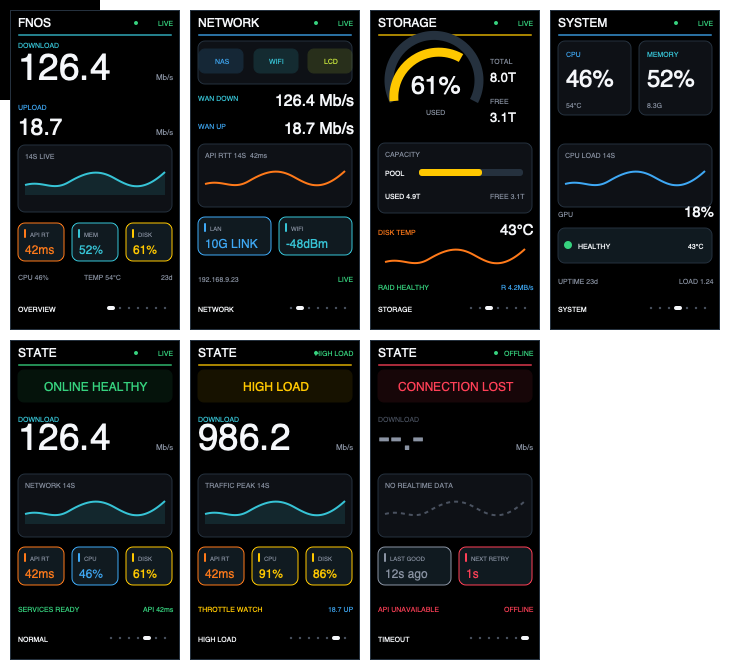

# fnOS Monitor UI v3 七页实现说明

UI v3 是面向 LilyGO T-Display-S3（ST7789、竖屏 170×320）的确定性实现。设计稿、固件坐标和自动测试共用同一组垂直区域，目标是让动态字符串、数值与单位在极端长度下仍有独立宽度预算。

## 七张原生分辨率设计稿

| 页 | 主问题 | PNG | SVG |
|---|---|---|---|
| 1 OVERVIEW | 当前网络吞吐与系统摘要 | [PNG](assets/ui-v3/01-overview-170x320.png) | [SVG](assets/ui-v3/01-overview-170x320.svg) |
| 2 NETWORK | NAS 到 LCD 的链路与时延 | [PNG](assets/ui-v3/02-network-170x320.png) | [SVG](assets/ui-v3/02-network-170x320.svg) |
| 3 STORAGE | 容量、温度和 RAID 健康 | [PNG](assets/ui-v3/03-storage-170x320.png) | [SVG](assets/ui-v3/03-storage-170x320.svg) |
| 4 SYSTEM | CPU、内存、GPU 与负载 | [PNG](assets/ui-v3/04-system-170x320.png) | [SVG](assets/ui-v3/04-system-170x320.svg) |
| 5 NORMAL | 正常在线时的健康摘要 | [PNG](assets/ui-v3/05-normal-170x320.png) | [SVG](assets/ui-v3/05-normal-170x320.svg) |
| 6 HIGH LOAD | 高负载触发原因 | [PNG](assets/ui-v3/06-high-load-170x320.png) | [SVG](assets/ui-v3/06-high-load-170x320.svg) |
| 7 TIMEOUT | 无可信实时数据的原因 | [PNG](assets/ui-v3/07-timeout-170x320.png) | [SVG](assets/ui-v3/07-timeout-170x320.svg) |

PNG 与 SVG 均由 `tools/render_ui_v3.py` 确定性生成。每张 SVG 的画布和视口都是 170×320；PNG 也保持 170×320，不再使用 AI 概念图作为逐像素实现依据。

## 固件布局契约

| 区域 | 坐标/高度 | 约束 |
|---|---:|---|
| 顶栏结束 | y=26 | 标题和可信度状态各自限宽 |
| 状态带 | y=30, h=32 | 只用于 NORMAL/HIGH LOAD/TIMEOUT |
| Hero 标签 | y=74 | DOWN 始终使用青色身份色 |
| Hero 数值 | y=84 | 数值宽度根据单位宽度实时扣除 |
| Hero 单位 | y=111 | 固定右锚点，不随数值位数移动 |
| 趋势面板 | y=134, h=63 | 标签与曲线分层，离线时使用虚线 |
| 指标卡 | y=207, h=38 | 三卡或双卡使用固定间距 |
| 摘要行 | y=266 | 左右文本独立裁剪，保留 8 px 间隔 |
| 页脚 | y=294 | 页名与七页指示器分区 |

所有动态标签经过 `fitLabel` / `drawBoundedLabel`；左右字段经过 `drawBoundedPair`；主数值和单位经过 `drawValueUnit`；温度的度数圆点单独绘制。放不下时缩短文字或降低数值字体，不允许覆盖相邻字段。

## 色彩与状态

- DOWN/RX：青色；UP/TX 与 CPU：蓝色；存储：黄色；API RTT/温度：橙色。
- LIVE/健康：绿色；高负载：黄色；OFFLINE：红色。
- `WARMING`、`LIVE`、`STALE`、`OFFLINE` 是数据可信度，不改变对象身份色。
- 缺失数据使用 `--` / `--.-`，真实 0 保持为有效测量。

## 实现与验证记录

- 固件标识：`render-v3.0-seven-page`。
- 页面实现：`drawOverview`、`drawNetwork`、`drawStorage`、`drawSystem`、`drawNormal`、`drawHighLoad`、`drawTimeout`。
- 自动测试：31 项通过，包含七页存在性、原生分辨率资源、区域互不重叠、动态字段宽度、真实数据和启动背光顺序。
- PlatformIO 环境：`fnos_monitor`，板卡 `lilygo-t-display-s3`，框架 Arduino。
- 构建结果：成功；RAM 50,172 / 327,680 bytes，Flash 952,853 / 6,553,600 bytes。
- 当前固件 SHA-256：`e819fd17c345f99caadf5148f579387415eb7df6e2339bd2ab3b416a7e081432`。
- 烧录目标：`/dev/cu.usbmodem141401`，Espressif USB JTAG/serial，VID:PID `303A:1001`。
- 烧录结果：OpenOCD 四段写入均为 `Verify OK`，并已执行 `reset run`。
- 运行日志：连续 10 个样本均包含 `ui=render-v3.0-seven-page`、`online=yes`、`fetch=ok`，未检测到 ERROR；日志保存在 `logs/ui-v3-runtime-final.log`。

编译、烧录校验和串口日志只能证明固件被写入且正在运行；字体可读性、色偏、残影和七页实体显示仍必须通过实机屏幕逐页观察确认。
